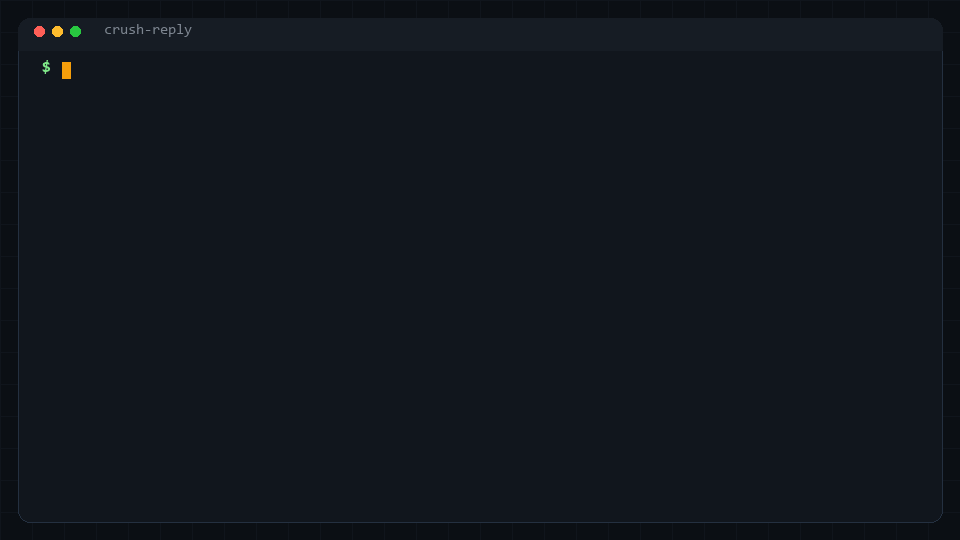

# crush-reply

**暧昧关系里的回复助手。** 500 张情境卡、107 条多轮链、100 条开场白、24 条挂着文献的心理学概念、一份对方画像、一份你自己的说话风格档案，和一个零依赖检索脚本。你不知道怎么回的时候，它帮你把话想清楚，再按你自己的说话习惯写出来。

[](LICENSE)
[](scripts/)
[](data/scenes)
[](data/threads)
[](data/openers.jsonl)
[](data/psych.jsonl)
[](CONTRIBUTING.md)


<p align="center">
  
</p>

上面这段是录的，不是画出来的：`query.py` 检索到 `period-003`，`demo.py` 把卡片、多轮链和开场白拼成一包，`harvest.py` 给出当天的检索词，最后 `psych.py` 说明这一层为什么有用。仓库里另有一张 `assets/preview.png`，用于 GitHub 的 Social preview。

---

## 它不是话术库

市面上多数「聊天技巧」是一堆可以复制粘贴的句子。这类东西有三个死穴：对方回什么你都得重新找、照抄一眼假、越用越像在演一个人。

crush-reply 存的是**情境**，不是句子。

| | 话术库 | crush-reply |
|---|---|---|
| 存什么 | 1000 条可复制的句子 | 500 张情境卡：现场、意图、方向、禁忌、续法 |
| 多轮怎么办 | 没有，只到第一句 | 107 条多轮链，写到第四轮和怎么收尾 |
| 没由头怎么办 | 让你「主动一点」 | 100 条开场白，按五种由头分 |
| 库里没有怎么办 | 用「通常女生都……」硬编 | 拆出检索词去公开平台找结构，再按你的语气写 |
| 怎么用 | 找到像的，复制 | 检索相近情境，再按画像重写 |
| 会不会重复 | 会，说法只有那么多 | 不会，每次重写 |
| 能不能长大 | 加句子，越来越乱 | 加卡、加链，有格式校验和检索回归 |

同一句话，两种给法。左边是话术库能给的（把常见写法拼一起），右边是它检索完再按你语气重写的：

```text
你说的       她晚上八点发：「疼得厉害了，坐着都难受」

话术库       1. 多喝热水，早点休息哦
             2. 心疼你，抱抱~
             3. 要不要我给你点份红糖水？照顾好自己

             ↑ 三句都对，但三句都不像你。她前一天刚说过
               「你别老发这种」，你还是发了，她知道你在搜模板。

crush-reply  【判断】她想被接住，不是要方案。她说「坐着都难受」，
             是在告诉你疼到没法待着，不是问你怎么办。

             【可以这样回】
             1（最稳） 这不是一般的肚子疼吧，你现在一个人在家还是有人陪
             2（给动作）我给你点份热的，二十分钟到楼下，你不用下楼我拿上去
             3（轻一点）先别坐着了，躺一下。等你不那么难受了跟我说一声

             【别这样回】多喝热水 / 忍一忍 / 吃点止痛药

             【她要是只回一个表情】不追。一小时后再问一句「好点没」，
             不要问「怎么不回我」

             ↑ 这三句按你的说话习惯改过：你一句平均 12 个字、不拆条、
               不用「~」、偶尔空格代替句号。所以看起来是你发的。
```

差别不在文采，在于三件事：它先判断这是哪种疼（疼到坐着都难受 vs 普通肚子疼）、它知道这个号上哪些话已经说过、它把你的句长和标点当硬约束，而不是给你一句「高情商回复」。

一张卡长这样：

```json
{"id":"period-003","scene":"period","title":"说肚子疼得厉害",
 "signal":"晚上八点她说「疼得厉害了，坐着都难受」，隔了很久才补一句「刚趴了一会儿」",
 "stage":["聊得来","暧昧","已在恋爱"],
 "goal":"认真接住疼，落到一个具体动作",
 "moves":["共情","认真回应","推进"],
 "examples":[{"style":"共情","text":"这句听着就知道不是一般的疼"},
             {"style":"认真","text":"你现在一个人在家还是有人陪，我想知道该不该过去"},
             {"style":"推进","text":"我给你点份热的汤，二十分钟到楼下"}],
 "taboo":["忍一忍就过去了","是不是吃坏东西了","吃点止痛药吧"],
 "followup":"她没回先不追，一小时后发「汤点了，放门口，你拿了再说一声」",
 "tags":["肚子疼","痛经","第一天"],"difficulty":2}
```

`examples` 是口径，不是可发文本。照抄会立刻露馅，`SKILL.md` 里明令禁止。

## 为什么还写多轮

因为只教第一句没用。真实的情况是：第一句勉强回过去了，她回了个「嗯」，然后你不知道接什么，对话就死在那儿。

所以每条链都写成「她一句、你一句、为什么这么走」，四轮左右，最后一句写**她没接的时候怎么收**。这部分比怎么回更值钱。

```json
{"id":"th-daily-03","scene":"daily","title":"她主动问在干嘛",
 "premise":"暧昧期，你们平时两三天聊一次，今天她先发消息",
 "turns":[{"her":"在干嘛","you":"刚把碗洗完，正想着晚上干点什么","why":"给一个具体画面，留话头"},
          {"her":"这么乖，还洗碗","you":"我妈说我再不洗就没饭吃。你呢，今天怎么这么闲","why":"自嘲一下，把话递回去"},
          {"her":"我也是刚忙完，躺着刷手机","you":"躺着刷手机最费时间。要不要换个姿势，走两步去楼下买杯东西","why":"从闲聊引到一个动作"},
          {"her":"这么晚还出去啊","you":"那就明天，下班那会儿我去你公司附近，十分钟的事","why":"把动作落到明天"}],
 "exit":"她答应就定时间；她说再说吧就到这儿，第二天别再提，隔两天聊别的",
 "tags":["在干嘛","主动","约","接话"],"difficulty":1}
```

## 三十秒试用

不用装任何东西，有 Python 就能跑：

```bash
git clone https://github.com/superwhb/crush-reply.git crush-reply
cd crush-reply

# 单条消息怎么回
python scripts/query.py --scene period "疼得厉害了，坐着都难受" --top 2

# 接下来几轮怎么走
python scripts/thread.py "她说想辞职，说完就不说话了"

# 想开口，但没由头
python demo.py "想找个话题，我们三天没聊了"
```

```text
查询: 疼得厉害了，坐着都难受    命中 2 张

[1] period-003  说肚子疼得厉害   难度2  阶段:聊得来/暧昧/已在恋爱
    现场: 晚上八点她说「疼得厉害了，坐着都难受」，隔了很久才补一句「刚趴了一会儿」
    目标: 认真接住疼，落到一个具体动作
    手法: 共情 / 认真回应 / 推进
    示例:
      - 共情  这句听着就知道不是一般的疼
      - 认真  你现在一个人在家还是有人陪，我想知道该不该过去
      - 推进  我给你点份热的汤，二十分钟到楼下
    别说: 忍一忍就过去了；是不是吃坏东西了；吃点止痛药吧
    续法: 她没回先不追，一小时后发「汤点了，放门口，你拿了再说一声」

[2] period-036  疼到干呕想吐   难度3  阶段:暧昧/已在恋爱
    现场: 「疼得想吐，刚才干呕了一下，现在什么都不敢吃，坐着都难受」
    目标: 认真接住，把疼到吐当成需要处理的信号
    手法: 认真回应 / 共情 / 推进
    示例:
      - 认真  疼到吐就别在家扛了，今天就去看
      - 共情  想吐的时候连水都不敢咽，太难熬
      - 推进  先别吃东西，我过来接你，十分钟到
    别说: 吃点东西压一压；喝口热的缓缓；撑到不疼就好了
    续法: 她不愿意去就退一步问「那有没有人陪你」，两小时后必须再确认一次

提醒: 卡片给的是方向，不要照抄。用你自己的话、按对方的画像重写成一句能直接发出去的微信。
```

检索是纯 Python：中文按字符二元组做倒排，BM25 排序，按场景和字段加权。没有 jieba，没有依赖，没有 API key。

`demo.py` 是懒人版：一条命令把画像、三张卡、两条多轮链、三条开场白拼成一段材料，末尾附固定输出格式。它**不调用任何模型**，产出可以整段贴给 ChatGPT / Claude / DeepSeek 用。

三个完整走流程的样例（输入、检索、输出、以及为什么那么改）：

- [她在吐槽食堂](examples/01-share-daily.md)
- [她说肚子疼得厉害](examples/02-period.md)
- [她说还是做朋友](examples/03-rejection.md)
- [她说想辞职，第二句之后才是真问题](examples/04-multi-turn.md)
- [库里没有这张卡的时候](examples/05-outside.md)
- [她说今晚跟男同事打游戏，为什么这句能说那句不能说](examples/06-psych.md)

## 安装成 skill

**Claude Code**

```bash
git clone https://github.com/superwhb/crush-reply.git ~/.claude/skills/crush-reply
```

**Codex / 其他支持 Agent Skills 的客户端**

`~/.codex/skills/crush-reply/`，或者客户端文档里写的那个 skills 目录，整个仓库放进去就行。

**DeepSeek Harness**

```bash
git clone https://github.com/superwhb/crush-reply.git ~/.dsh/skills/crush-reply
```

**手动**：把仓库路径发给模型，让它先读 `SKILL.md`。

### 各客户端的目录与格式

| 客户端 | skill 目录 | frontmatter 要求 |
|---|---|---|
| Claude Code | `~/.claude/skills/<名字>/SKILL.md` | `name` 必须等于目录名，`description` 是触发条件 |
| Codex CLI | `~/.codex/skills/<名字>/SKILL.md` | 同上 |
| DeepSeek Harness | `~/.dsh/skills/<名字>/SKILL.md` | 同上，另外支持 `PROMPT.md` 形式的旧插件 |
| Cursor / 其他 | 客户端文档里的 skills 目录 | 同 Agent Skills 规范 |

三个客户端的格式要求是一致的（Agent Skills 规范），所以同一份仓库可以直接放进去，不用改。

### 装完先跑自检

```bash
python scripts/doctor.py
```

它会查五件事：frontmatter 的 `name` 和目录名是否一致、必需文件是否齐全（11 个）、数据文件是不是 UTF-8 无 BOM、三个 lint 加一条检索冒烟能不能过、这个目录在不在某个客户端的 skills 路径下。全过就八行 `ok`；有问题会直接告诉你是哪一条、怎么改。

```text
crush-reply doctor · /Users/you/.claude/skills/crush-reply
python 3.12.1

一、这个目录能不能被客户端读到
  ok  frontmatter name = crush-reply
  ok  装在 Claude Code 的 skills 目录下
二、数据文件
  ok  11 个必需文件都在
三、编码
  ok  数据文件都是 UTF-8 无 BOM
四、校验与检索
  ok  卡片 lint 通过
  ok  多轮链与开场白 lint 通过
  ok  心理学概念 lint 通过
  ok  检索冒烟通过（period 能命中）
----------------------------------------------
全部通过（8 项）。可以开始用了
```

### 装不上怎么办

四条最常见的原因，按这个顺序对：

1. **frontmatter 的 `name` 和目录名不一致** —— `SKILL.md` 里写的是 `crush-reply`，你解压出来的目录叫 `crush-reply-main`，客户端就不会加载。改目录名，或者改 frontmatter。
2. **放错了位置** —— Claude Code 只读 `~/.claude/skills/` 下面一层，`~/Downloads/crush-reply` 里的不会被看到。
3. **数据只拷了一部分** —— `data/scenes/` 要 10 个 jsonl，`data/threads/` 要 10 个 jsonl。少一个，`doctor.py` 会点名。
4. **文件被编辑器存成了 GBK** —— Windows 记事本另存时会这样。重存为 UTF-8 无 BOM，或者直接用 `git clone` 拿一份没动过的。

还有一种：客户端读到了 skill 但没有按预期回答。多半是它没读到 `data/` 里的文件（有些客户端只把 `SKILL.md` 塞进上下文）。这种情况在对话里直接说「读 `data/scenes/period.jsonl`，用 `scripts/query.py` 检索」，或者跑 `demo.py` 把材料拼好贴给它。

装完先让它建一份画像：

```bash
python scripts/profile.py new 小鹿
```

然后编辑 `profiles/小鹿.md`，填关系阶段、MBTI、星座、作息、饮食、雷区、近期事件。**只填知道的，不确定就空着，不要替对方编。**

再花五分钟填 `voices/` 里你自己的说话风格，贴几条你真发过的消息。有没有这个，回复像不像你，差别很大。

## 让它像你说话

这是这个仓库和「AI 帮你写情话」最大的区别：**它不写它自己的句子，它写你的句子。**

```bash
python scripts/voice.py new 小鹿        # 建档案（文件名跟画像代号一致）
python scripts/voice.py check           # 至少三条样例才算学得像
python scripts/voice.py show 小鹿       # 看现在都记了什么
```

档案里只记四件事，没有形容词：

1. 一句多长，会不会拆成两条发
2. 用不用句号、问号、「~」、「……」，用不用 emoji，常用哪几个
3. 有哪些口头禅，哪些词你从来不这么说
4. 五到十条你真发过的消息（最好像你平时，不是最像样子）

照着这几条填好，模型就按你的句长、标点、连发节奏重写。没有档案时它会用最短的口语，并在回答最后问你要三条原话——**问原话比问「你想要什么风格」有用**，因为几乎没人能准确描述自己的说话方式。

这件事写进了 `SKILL.md` 的重写规则和 `demo.py` 的输出指令里，不是可选项。

## 判断有出处

卡片说「这么回」，`data/psych.jsonl` 说「为什么这么回有用」。24 条概念，来自公开发表的研究与临床写作，不是二手公众号：

- 情绪确认（Linehan 1993）
- 四骑士、修复尝试、正负比、生理性淹没（Gottman 1994 / 1999）
- 依恋焦虑、回避、抗议行为（Hazan & Shaver 1987；Bowlby 1969）
- 非暴力沟通四步（Rosenberg 2003）
- 主动建设性回应（Gable 2004）、自我表露互惠（Altman & Taylor 1973）
- 道歉的四个成分（Lewicki / Polin / Lount 2016）

```bash
python scripts/psych.py "她一直不回我，我就很想再发一条"
```

```text
ps-005  依恋焦虑   [Hazan & Shaver 1987 成人依恋研究]
  用在哪: 对方回得慢一点你就反复看手机，想再发一条确认
  一句话: 想确认对方还在，是焦虑型依恋常见的反应，不代表你小心眼
  怎么做: 把「你在干嘛」换成说自己的状态，给一次不索要回应的消息
  别用成: 不要连续追问三次以上，追问换来的回复不算真的回应
```

它只做一件事：把「我该怎么回」变成「她这句在表达什么」。三条硬规则写进了 `scripts/lint_psych.py`，违了 CI 会红：

1. **不给对方下诊断** —— 不许出现「你就是回避型」「确诊」「治愈」这类说法，概念是解释现场的工具，不是给人贴的标签。
2. **不写「网上都说」** —— 每条必须挂具体文献（作者 + 年份），写不出出处就不收。
3. **每类场景至少两条** —— 十个场景，任何一个场景在两分钟内找不到能解释它的概念，说明这一层的覆盖面不够。

用法上它排在卡片后面：先去检索三张卡，卡给了方向，再看概念，决定这一句是接情绪还是给台阶。`SKILL.md` 里明确写了「不要把概念名说给对方听」——说「你在情绪淹没里」比不说更糟。

完整走一遍的例子见 [她说今晚跟男同事打游戏，为什么这句能说那句不能说](examples/06-psych.md)。

## 它怎么工作

```
用户:「她发了个食堂菜的照片说又是这个，我该回啥」
   │
   ├─ 1. 读画像      profiles/小鹿.md      关系阶段、MBTI、雷区、近期事件
   ├─ 2. 定场景      daily / period / …    十个场景，选一个或两个
   ├─ 3. 检索        scripts/query.py      命中 3 张情境卡
   │                 scripts/thread.py     命中 2 条多轮链
   │                 data/openers.jsonl    没有由头时找 3 条开场
   │                 scripts/psych.py      2 条概念，说明为什么这么回有用
   │                 一张都不像 → scripts/find.py 拆检索词，去外面找结构
   └─ 4. 重写        SKILL.md 的规则       按阶段、画像、你的语气写成一句
                                              │
                                              ▼
         【判断】她这条是想被接住，不要方案
         【可以这样回】三条，按轻重排
         【别这样回】写具体的错句，不是抽象原则
         【她要是只回一个表情，你就过二十分钟拍自己那份饭】
         【第二三轮注意】她变短了就停，别连问
```

四个细节值得说：

1. **检索只负责缩小范围**。模型看 3 到 5 张卡，再多会互相干扰。
2. **重写受三条约束**：关系阶段的音量、你自己的句式和标点、对方的画像。
3. **每条回复都要留话头**。不能接下去的回答，写得再漂亮也是死的。
4. **多轮链只借节奏，不借台词**。照念第一句像人，照念第四句就不像了。

## 库里没有的时候

500 张卡也盖不住所有人。真遇到库里没有的情况，它有三个选择：编一张像的、套一句「通常女生都……」，或者承认没有。

前两个都会让你在聊天里露馅。所以这个仓库选第三个，但它不只说「没有」：

```bash
python scripts/find.py "她说你根本不懂我在气什么"
```

这条命令不联网，只做三件事：

1. 猜场景（猜不出就老实说猜不出）
2. 把你这句原话拆成检索词——库里认得的标签词优先，认不得就用原话加引号
3. 给一段提炼模板：她的原话 / 拆出来的检索词 / 搜完怎么提炼（她要什么、那些回复共同的动作、哪条在你这阶段不成立、你会发的一句）

然后模型拿前两三条检索词去搜小红书、知乎、豆瓣小组，**只提炼结构，不抄句子**，最后用 `voices/` 的句式把那一句写出来。回答里必须写清「这个情况库里没有」，而不是假装检索到了。

想留痕就加 `--note`，记进 `research/gaps/<日期>.md`。同一类出现三次，才值得补一张卡；只出现一次的，通常是个例，不用管。完整示例见 [库里没有这张卡的时候](examples/05-outside.md)。

## 数据

| 场景 | 文件 | 卡片 | 多轮链 | 覆盖 |
|---|---|---|---|---|
| 分享日常 | `data/scenes/daily.jsonl` | 50 | 12 | 吐槽、分享、暗示、久不回、自拍、语音 |
| 生理期 | `data/scenes/period.jsonl` | 50 | 11 | 经前、第一天、疼、情绪崩、周期异常 |
| 闹矛盾 | `data/scenes/conflict.jsonl` | 50 | 12 | 你自己的错、外部摩擦、冷战修复、说重话 |
| 吃醋 | `data/scenes/jealousy.jsonl` | 50 | 11 | 前任、异性朋友、被比较、被表白 |
| 深夜情绪 | `data/scenes/latenight.jsonl` | 50 | 10 | 失眠、emo、自我否定、危机 |
| 约出来 | `data/scenes/meetup.jsonl` | 50 | 11 | 开口、定时间、被拒、改期、迟到 |
| 家人与家庭 | `data/scenes/family.jsonl` | 50 | 10 | 父母反对、催婚、家里出事、丧亲 |
| 异地 | `data/scenes/distance.jsonl` | 50 | 10 | 时差、见不到、谁去谁的城、见不到尽头 |
| 朋友与社交 | `data/scenes/friends.jsonl` | 50 | 10 | 她朋友怎么看你、聚会、男性朋友、被晾着 |
| 生日与纪念日 | `data/scenes/anniversary.jsonl` | 50 | 10 | 忘了日子、礼物、要不要发朋友圈、红包 |

难度分布：日常轻量 112 张、要判断情绪 230 张、容易翻车 158 张。
风格分布：认真 429 条、共情 325 条、退让 221 条、反向好奇 198 条、推进 150 条、自嘲 99 条、玩梗 54 条。

除了这三类内容，还有三份索引：

- `data/psych.jsonl`：24 条心理学概念，每条挂公开文献，用来解释「为什么这么回有用」。只做参照，不给对方贴标签。
- `data/memes.jsonl`：梗的元信息，包括起源时间、适用情绪、什么场合别用。**不存「当下最火」的结论**，那个三个月就过期，用过期梗比不用梗更扣分，所以用之前要联网确认。
- `data/stickers.json`：表情包按情绪索引，只存「什么时候发什么情绪、搜什么词」。图片不放进仓库，版权和体积都扛不住，读你本地那个表情包目录就行。

## 检索质量

`evals/cases.jsonl` 是 40 条真人会问的句子，十个场景每个至少三条，每条写明应该命中哪一类卡。改检索参数就跑：

```bash
python scripts/eval.py -v
```

```text
用例 40 条
hit@1 37/40 = 92%
hit@3 38/40 = 95%
```

CI 要求 `hit@3 ≥ 90%`，跌破就红。这就是这个仓库不靠「我觉得搜得准」的地方：加卡可能把好结果挤下去，评测会挡住。现在剩下的两条 MISS 都是「这句话本身就该由人多问一句」——问「我们算什么关系」这类要在对话里才判得准的句子，检索给的三张卡都只是近邻，`SKILL.md` 里写明这时候宁可说实话也不要硬指一张。

## 它怎么长大

500 张卡是静态的，人的说话方式不是。所以仓库里带了一条「每天看一点」的轻流程，在 `research/`：

```bash
python scripts/harvest.py plan            # 今天该搜的三组词（按日期轮转，跳过最近搜过的主题）
#   └─ 用你的搜索工具搜这三组，挑 2-3 篇没看过的读完
python scripts/harvest.py check           # 校验候选，并列出每条候选在库里的两张最近邻卡
python scripts/harvest.py promote hb-0007 # 值得进库的，出卡片骨架，自己改完再 lint
```

它**不抓取**。小红书和抖音没有可用的公开接口，反爬也强，爬下来的东西带版权和隐私问题，所以这个仓库里没有爬虫，也没有一行抄来的句子。每条素材都是「人读完，用自己的话写一句情境 + 一句缺口 + 一句提炼」，加上原文链接：

```json
{"id": "hb-0004", "date": "2026-11-14", "platform": "news", "url": "https://…", "title": "失眠安慰语",
 "scene_guess": "latenight",
 "situation": "她说睡不着，你回「别想太多，早点睡」，她再没说话",
 "gap": "latenight 卡偏情绪安抚，缺「哪几句安慰本身就是否定她」的清单",
 "insight": "「别想太多」「我有时候也这样」「你就是作息乱」这三句一律不用，先承认她此刻难受",
 "verdict": "keep"}
```

三条口径写在 [research/README.md](research/README.md)，其中一条值得单独拎出来：**小红书情感帖评论区有大量「劝分」内容**（腾讯新闻和界面新闻都报道过这个现象）。那套话术的结论是「离开」，这个仓库的结论是「先把这句话说好」，方向相反，所以看到这类内容直接 `verdict: reject`。`research/inbox/` 里已经留了第一批 5 条样本，包括一条 reject——看得见「什么不该学」比看得见「什么该学」更重要。

`check` 会把候选和现有 500 张卡比一遍，列出最近的卡和共同词，但**只提示不裁决**：一句话的情境做自动查重不可靠，最后那一眼得人看。

### 每天自动开一个 issue

这三步现在有 GitHub Actions 版，`.github/workflows/daily.yml`：

- 每天 09:30（北京时间）跑 `harvest.py plan`，把当天的三组检索词开成一个 issue，标签 `daily-intel`
- issue 里写清「怎么算做完」：挑 2-3 篇搜、只提炼结构、`verdict` 怎么填
- 你或者任何路过的人都能认领：把候选写进 `research/inbox/<日期>.jsonl`、开 PR，CI 跑 `harvest.py check`
- 当天已经有 open 的 issue 时，它改成在该 issue 下追加评论，不会刷屏

所以这个仓库的「长大」不依赖某个人记得每天去看，日历会推它。

## 加内容

一条链、一张卡、一句开场白，都是一个文件一行 JSON，跑一下检查，提 PR。不用写代码。

```bash
# 读完 data/schema.md，用脚本加，字段和枚举它会帮你验
python scripts/new_card.py                       # 一步步问，写完自动 lint
python scripts/new_card.py --scene period --title "…" --signal "…" \
    --goal "…" --stage 暧昧 --moves 共情,认真回应 \
    --example "共情=…" --example "推进=…" \
    --taboo "…" --followup "…" --tags … --difficulty 2

# 手动改文件的话，三件事都要跑
python scripts/lint_data.py      # 情境卡：缺字段、id 重复、红线词，报到行号
python scripts/lint_extra.py     # 多轮链与开场白
python scripts/lint_psych.py     # 心理学概念：诊断式表述、来源、场景覆盖
python scripts/eval.py           # 检索回归
```

`new_card.py` 做三件事：自动取下一个没被占用的 id、按 `lint_data.py` 的同一套规则当场验、写进去之后整体 lint 不过就自动回滚。它和 CI 用的是同一个 `check_card()`，不会出现「本地过了 CI 红」这种事。

CI 会跑 `lint_data.py`、`lint_extra.py`、`lint_psych.py`、`lint_skill.py` 和 `eval.py`。红线词、称呼词、超长示例、枚举外的值、诊断式表述、让检索变差的改动，都进不来。细节看 [CONTRIBUTING.md](CONTRIBUTING.md)。

## 内容来源与免责声明

**数据怎么来的。** 500 张卡、107 条链、100 条开场白，是读完公开的情感咨询、沟通研究、以及小红书/知乎/豆瓣等平台上的公开讨论后，**用自己的话重写的情境结构**，不是抄来的句子。每张卡存的是「现场信号 + 目标 + 三种方向 + 禁忌 + 续法」，句子是模型按你的画像和语气现写的。`data/psych.jsonl` 的 24 条概念逐条挂了公开文献。

**它不是什么。**
- 不是心理咨询，不诊断任何人的依恋类型或人格，`lint_psych.py` 里禁掉了「你就是」「确诊」「治愈」这类说法。
- 不保证结果。同一句话对不同的人效果相反，这套东西只帮你把想说的说清楚。
- 不采集你的聊天记录。所有画像、语气档案、缺口记录都在你本地，`.gitignore` 里排除了 `profiles/*.md`、`voices/*.md` 和 `research/gaps/*.md`。

**遇到真问题的时候。** 如果对方出现自伤、绝望、被家暴、涉及未成年人的信号，这个仓库的所有话术都不适用。先确认安全，再联系她的家人朋友，中国大陆可拨 12356（心理援助热线），紧急情况 110 / 120。`latenight` 场景里这类卡一律标注「优先确认安全」，不给调情建议。

**版权与许可。** 代码 MIT；`data/` 下的内容以 CC BY-SA 4.0 提供（见 [LICENSE-DATA](LICENSE-DATA.md)）。商用、改写、二次分发都可以，保留署名、以相同方式共享。

## 红线

这些写在 `SKILL.md`、`data/schema.md` 和 `scripts/lint_data.py` 三处，改代码也绕不过 CI：

- 不写打压、冷处理、假装忙、欲擒故纵、试探性欺骗、性暗示。
- 不替用户编人设。他没那么忙，就不会出现「刚开完会」。
- 对方明确拒绝后，只给体面退场，不给「再试一次」。
- 不碰未成年人。
- 出现自伤或绝望的信号，立刻停止恋爱建议，给专业资源（中国大陆可拨 12356），并建议告诉身边可信任的人。
- 不承诺结果。不说「这样回她一定开心」。

立场就一句：**帮你把想法说出来，不是帮你演一个人。**

## Roadmap

- [x] 情境卡扩到 500 张，场景从 6 类扩到 10 类
- [x] 107 条多轮链，写到第四轮和收尾
- [x] 100 条开场白，按五种由头分
- [x] 库里没有时拆检索词、去公开平台找结构（`scripts/find.py`）
- [x] 说话风格档案 `voices/`，回复按本人句式重写（`scripts/voice.py`）
- [x] `demo.py` 把整条链路串成一包
- [x] 检索回归评测，CI 卡 hit@3
- [x] `research/` 每日情报：检索词轮转、来源登记、候选转卡（不抓取）
- [x] 每日情报接进 GitHub Actions，每天自动开检索 issue
- [x] `query.py --explain`：打印命中了哪些词、场景加成多少、为什么这张排第一
- [x] 24 条心理学概念层，每条挂公开文献（`data/psych.jsonl` + `scripts/psych.py`）
- [x] `scripts/doctor.py`：装完自检，五类常见问题直接点名
- [x] `scripts/new_card.py`：加卡不写 JSON，当场校验、失败回滚
- [x] issue / PR 模板：卡片缺口、报错、缺场景三类
- [ ] 繁简双语数据（`data/scenes-zh-Hant/`）
- [ ] 表情包本地目录约定 + 一个 `stickers.py` 扫描器
- [ ] grep baseline 对照，证明检索不是自说自话
- [ ] MCP server 形态，挂到任意客户端
- [ ] 从真实聊天记录导出的 `voices/` 半自动生成（只在本地跑，不上传）

## English

crush-reply is an open Chinese-language Agent Skill for people who freeze up when texting someone they like. Instead of a phrasebook, it ships 500 structured "situation cards" (context, intent, moves, taboos, follow-up), 107 multi-turn threads that cover the second and third reply where most advice stops, and 100 conversation openers grouped by anchor type. When nothing in the library fits, it turns your sentence into search phrases, reads public discussions for the *structure* only, and says plainly that the case is not in the library. A `voices/` profile stores how you actually text — sentence length, punctuation, whether you split one thought into two messages — and every reply is rewritten in that style. Retrieval is a dependency-free BM25 over Chinese character bigrams with a scene prior and a 40-case eval set that gates CI. It refuses manipulation tactics, and the refusal is enforced by lint, not just by a README. A scheduled GitHub Action opens an issue every morning with that day's search phrases, so the library keeps growing without anyone remembering to feed it. MIT licensed, and every data point is one JSON object per line, so contributing is a one-line PR.

## License

MIT. 数据里的示例句子由贡献者原创，不要搬运别人视频或文章的文案。
